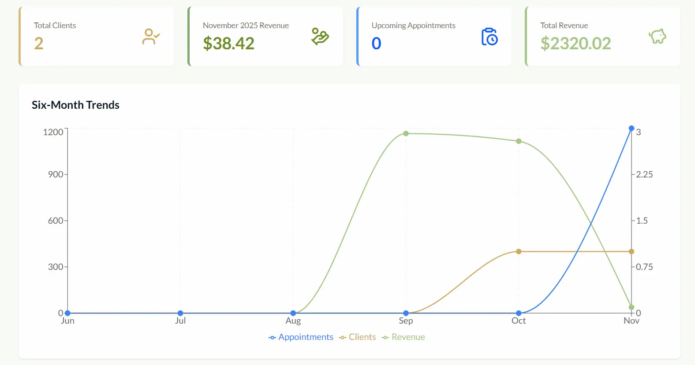

# WorkHub

A client, appointment and invoice management app for freelancers and small businesses. It keeps your clients, schedule, billing and revenue stats in one dashboard.



## Features

- **Authentication**: email/password sign-up (bcrypt-hashed) and Google OAuth, with JWT sessions via NextAuth.
- **Clients**: add, edit and delete clients, view a client detail page with per-client stats.
- **Appointments**: calendar view and list view, with upcoming, completed and canceled statuses.
- **Invoices**: create invoices with line items and tax, mark them paid or unpaid, filter by status, and export them as PDF.
- **Analytics**: monthly revenue, client totals and trend charts (bar and line).
- **Profile**: manage personal and business information.
- **Protected routes**: middleware and per-user data scoping, so users only see their own data.
- **Landing page** with hero, features, showcase and testimonials sections.

## Tech Stack

| Area              | Technology                                                                   |
| ----------------- | ---------------------------------------------------------------------------- |
| Framework         | [Next.js 16](https://nextjs.org/) (App Router), React 19, TypeScript         |
| Styling           | Tailwind CSS 4                                                               |
| Database          | MongoDB with [Mongoose](https://mongoosejs.com/)                             |
| Auth              | [NextAuth.js](https://next-auth.js.org/) v4 (Credentials + Google), bcryptjs |
| Charts / Calendar | Recharts, react-calendar                                                     |
| PDF               | jsPDF                                                                        |
| Icons             | lucide-react                                                                 |

## Getting Started

### Prerequisites

- Node.js 20.9 or newer
- A MongoDB database (a free [MongoDB Atlas](https://www.mongodb.com/atlas) cluster works)
- _(Optional)_ A Google OAuth client for "Sign in with Google"

### Installation

```bash
git clone https://github.com/cptkorts/WorkHub.git
cd WorkHub
npm install
```

### Environment variables

Copy the example file and fill in your values:

```bash
cp .env.example .env.local # Windows (PowerShell): Copy-Item .env.example .env.local
```

| Variable               | Description                                                |
| ---------------------- | ---------------------------------------------------------- |
| `MONGODB_URI`          | MongoDB connection string                                  |
| `NEXTAUTH_URL`         | App URL, e.g. `http://localhost:3000`                      |
| `NEXTAUTH_SECRET`      | Random secret. Generate one with `openssl rand -base64 32` |
| `GOOGLE_CLIENT_ID`     | Google OAuth client ID (optional)                          |
| `GOOGLE_CLIENT_SECRET` | Google OAuth client secret (optional)                      |

To set up Google sign-in, create an OAuth client in the [Google Cloud Console](https://console.cloud.google.com/apis/credentials). Add `http://localhost:3000/api/auth/callback/google` as an authorized redirect URI.

### Run

```bash
npm run dev       # development server at http://localhost:3000
npm run build     # production build
npm start         # run the production build
npm run lint      # lint the code
```

## Project Structure

```
app/          Pages and API routes (clients, appointments, invoices, analytics, user/profile, auth)
components/   UI components
hooks/        Data-fetching and form hooks
lib/          Auth config, MongoDB connection, Mongoose models
utils/        PDF invoice generation
middleware.ts Route protection
```

## Deployment

The easiest option is [Vercel](https://vercel.com/). Add the environment variables above, set `NEXTAUTH_URL` to your production URL, and add the production Google OAuth redirect URI.

## License

The source code is released under the [MIT License](LICENSE). Third-party assets listed below keep their own licenses.

## Credits

- Illustration "Financial data" by [Storyset](https://storyset.com/) (Freepik). Attribution is required under the Storyset license.
- Font "Molgan" by Brandsemut. Check the font's license before reusing or redistributing it.

## !USER FOR TESTING! 
email: test@test.com
password: test1234

